<!-- dprint-ignore-file -->
<!-- markdownlint-disable MD013 MD060 -->

# Module map

Generated by `just module-map`. Do not edit this file by hand.

Open [the interactive diagram](../reports/module-map/index.html) after generating it locally.
CI attaches the same offline HTML as the `module-map` artifact.

## Reading this map

This map uses Nix's evaluated import graphs, including embedded Home Manager graphs.
It records imports, not whether each option, package or service is enabled.
Flake wiring registers configurations and public modules; it is not a deployed machine.
Optional workstation variants show supported compositions, not additional machines.
External work repositories and arbitrary extra modules are outside this evaluation.

Run `just module-map-check` to detect stale diagrams and changed usage.
A failed evaluation stops generation; partial results never replace the snapshot.

## Machines and profiles

| Context | Kind | Imported local files |
| --- | --- | ---: |
| Flake wiring | wiring | 48 |
| apps | NixOS | 9 |
| bragi | NixOS | 21 |
| donar | NixOS | 60 |
| forgejo | NixOS | 7 |
| forgejo-lab | NixOS | 5 |
| frigg | NixOS | 52 |
| homepage | NixOS | 9 |
| proxy | NixOS | 6 |
| wodan | NixOS | 64 |
| loki | Darwin | 15 |
| david@mimir2 | Home Manager | 13 |
| mimir2 + workstation | optional | 30 |
| loki + workstation | optional | 32 |

## Entry points

Only direct local roots appear here. The HTML contains every local import edge.

```mermaid
flowchart LR
  c0["Flake wiring"]
  c0 --> m0["flake.nix"]
  c1["apps"]
  c1 --> m6["modules/cachix.nix"]
  c1 --> m26["modules/features/selfhosted-apps.nix"]
  c1 --> m104["modules/internal-pki.nix"]
  c1 --> m116["modules/roles/proxmox-guest.nix"]
  c1 --> m123["servers/apps/hardware-configuration.nix"]
  c2["bragi"]
  c2 --> m1["hosts/bragi/hardware-configuration.nix"]
  c2 --> m6["modules/cachix.nix"]
  c2 --> m18["modules/features/hyprland.nix"]
  c2 --> m20["modules/features/keyboard.nix"]
  c2 --> m36["modules/home/codex-mcp.nix"]
  c2 --> m104["modules/internal-pki.nix"]
  c2 --> m111["modules/roles/desktop-base.nix"]
  c3["donar"]
  c3 --> m2["hosts/donar/hardware-configuration.nix"]
  c3 --> m6["modules/cachix.nix"]
  c3 --> m21["modules/features/laptop.nix"]
  c3 --> m104["modules/internal-pki.nix"]
  c3 --> m113["modules/roles/full-workstation.nix"]
  c4["forgejo"]
  c4 --> m6["modules/cachix.nix"]
  c4 --> m33["modules/forgejo.nix"]
  c4 --> m104["modules/internal-pki.nix"]
  c4 --> m116["modules/roles/proxmox-guest.nix"]
  c5["forgejo-lab"]
  c5 --> m6["modules/cachix.nix"]
  c5 --> m33["modules/forgejo.nix"]
  c5 --> m104["modules/internal-pki.nix"]
  c5 --> m119["modules/server-locale.nix"]
  c5 --> m120["modules/server-nix.nix"]
  c6["frigg"]
  c6 --> m3["hosts/frigg/hardware-configuration.nix"]
  c6 --> m6["modules/cachix.nix"]
  c6 --> m21["modules/features/laptop.nix"]
  c6 --> m36["modules/home/codex-mcp.nix"]
  c6 --> m104["modules/internal-pki.nix"]
  c6 --> m115["modules/roles/kde-workstation.nix"]
  c7["homepage"]
  c7 --> m6["modules/cachix.nix"]
  c7 --> m17["modules/features/homepage.nix"]
  c7 --> m104["modules/internal-pki.nix"]
  c7 --> m116["modules/roles/proxmox-guest.nix"]
  c7 --> m124["servers/homepage/hardware-configuration.nix"]
  c8["proxy"]
  c8 --> m6["modules/cachix.nix"]
  c8 --> m104["modules/internal-pki.nix"]
  c8 --> m116["modules/roles/proxmox-guest.nix"]
  c9["wodan"]
  c9 --> m4["hosts/wodan/hardware-configuration.nix"]
  c9 --> m6["modules/cachix.nix"]
  c9 --> m24["modules/features/nvidia-workstation.nix"]
  c9 --> m29["modules/features/wodan-home.nix"]
  c9 --> m104["modules/internal-pki.nix"]
  c9 --> m107["modules/proxmox-lab.nix"]
  c9 --> m113["modules/roles/full-workstation.nix"]
  c10["loki"]
  c10 --> m7["modules/darwin-keyboard.nix"]
  c10 --> m27["modules/features/terminal.nix"]
  c10 --> m39["modules/home/darwin-keyboard.nix"]
  c11["david@mimir2"]
  c11 --> m27["modules/features/terminal.nix"]
  c12["mimir2 + workstation"]
  c12 --> m27["modules/features/terminal.nix"]
  c12 --> m122["modules/workstation.nix"]
  c13["loki + workstation"]
  c13 --> m7["modules/darwin-keyboard.nix"]
  c13 --> m27["modules/features/terminal.nix"]
  c13 --> m39["modules/home/darwin-keyboard.nix"]
  c13 --> m122["modules/workstation.nix"]
```

## Files outside the evaluated graphs

These are investigation candidates, not proven dead code. Ordinary Nix imports used as
helpers or consumers outside this repository can be absent from a module graph.

- [modules/feed-sync.nix](../modules/feed-sync.nix)

## Possible absorption

Heuristic: at most 60 source lines, exactly one observed local importer and the same
evaluated consumers as that importer. Review public exports and option boundaries
before merging. These checks do not establish semantic redundancy.

| Module | Lines | Only observed importer |
| --- | ---: | --- |
| [modules/home/darwin-speech.nix](../modules/home/darwin-speech.nix) | 31 | modules/home/portable-cli.nix |
| [modules/home/development/cloud.nix](../modules/home/development/cloud.nix) | 13 | modules/home/workstation/development/packages.nix |
| [modules/home/terminal/archives.nix](../modules/home/terminal/archives.nix) | 16 | modules/home/terminal/packages.nix |
| [modules/home/terminal/data.nix](../modules/home/terminal/data.nix) | 20 | modules/home/terminal/packages.nix |
| [modules/home/terminal/network.nix](../modules/home/terminal/network.nix) | 20 | modules/home/terminal/packages.nix |
| [modules/home/terminal/shell.nix](../modules/home/terminal/shell.nix) | 39 | modules/home/terminal/packages.nix |
| [modules/home/terminal/system.nix](../modules/home/terminal/system.nix) | 25 | modules/home/terminal/packages.nix |
| [modules/home/workstation/development/core.nix](../modules/home/workstation/development/core.nix) | 37 | modules/home/workstation/development/packages.nix |
| [modules/home/workstation/development/default.nix](../modules/home/workstation/development/default.nix) | 6 | modules/home/workstation/default.nix |
| [modules/home/workstation/development/mantle.nix](../modules/home/workstation/development/mantle.nix) | 24 | modules/home/workstation/development/default.nix |
| [modules/home/workstation/development/packages.nix](../modules/home/workstation/development/packages.nix) | 8 | modules/home/workstation/development/default.nix |
| [modules/home/workstation/development/security.nix](../modules/home/workstation/development/security.nix) | 9 | modules/home/workstation/development/packages.nix |
| [modules/home/workstation/development/tooling.nix](../modules/home/workstation/development/tooling.nix) | 30 | modules/home/workstation/development/packages.nix |
| [modules/home/workstation/media-tools.nix](../modules/home/workstation/media-tools.nix) | 15 | modules/home/workstation/default.nix |
| [modules/home/workstation/terminal/archives.nix](../modules/home/workstation/terminal/archives.nix) | 11 | modules/home/workstation/terminal/packages.nix |
| [modules/home/workstation/terminal/data.nix](../modules/home/workstation/terminal/data.nix) | 36 | modules/home/workstation/terminal/packages.nix |
| [modules/home/workstation/terminal/default.nix](../modules/home/workstation/terminal/default.nix) | 5 | modules/home/workstation/default.nix |
| [modules/home/workstation/terminal/network.nix](../modules/home/workstation/terminal/network.nix) | 24 | modules/home/workstation/terminal/packages.nix |
| [modules/home/workstation/terminal/packages.nix](../modules/home/workstation/terminal/packages.nix) | 9 | modules/home/workstation/terminal/default.nix |
| [modules/home/workstation/terminal/shell.nix](../modules/home/workstation/terminal/shell.nix) | 32 | modules/home/workstation/terminal/packages.nix |
| [modules/home/workstation/terminal/system.nix](../modules/home/workstation/terminal/system.nix) | 27 | modules/home/workstation/terminal/packages.nix |

## Machine-module matrix

S = system import; H = Home Manager import; I = flake wiring import.

| Module | Flake wiring | apps | bragi | donar | forgejo | forgejo-lab | frigg | homepage | proxy | wodan | loki | david@mimir2 | mimir2 + workstation | loki + workstation |
| --- | --- | --- | --- | --- | --- | --- | --- | --- | --- | --- | --- | --- | --- | --- |
| [flake.nix](../flake.nix) | I | · | · | · | · | · | · | · | · | · | · | · | · | · |
| [hosts/bragi/hardware-configuration.nix](../hosts/bragi/hardware-configuration.nix) | · | · | S | · | · | · | · | · | · | · | · | · | · | · |
| [hosts/donar/hardware-configuration.nix](../hosts/donar/hardware-configuration.nix) | · | · | · | S | · | · | · | · | · | · | · | · | · | · |
| [hosts/frigg/hardware-configuration.nix](../hosts/frigg/hardware-configuration.nix) | · | · | · | · | · | · | S | · | · | · | · | · | · | · |
| [hosts/wodan/hardware-configuration.nix](../hosts/wodan/hardware-configuration.nix) | · | · | · | · | · | · | · | · | · | S | · | · | · | · |
| [modules/boot.nix](../modules/boot.nix) | · | · | S | S | · | · | S | · | · | S | · | · | · | · |
| [modules/cachix.nix](../modules/cachix.nix) | · | S | S | S | S | S | S | S | S | S | · | · | · | · |
| [modules/darwin-keyboard.nix](../modules/darwin-keyboard.nix) | · | · | · | · | · | · | · | · | · | · | S | · | · | S |
| [modules/default.nix](../modules/default.nix) | I | · | · | · | · | · | · | · | · | · | · | · | · | · |
| [modules/features/browsers.nix](../modules/features/browsers.nix) | I | · | · | H/S | · | · | H/S | · | · | H/S | · | · | · | · |
| [modules/features/communication.nix](../modules/features/communication.nix) | I | · | · | H/S | · | · | H/S | · | · | H/S | · | · | · | · |
| [modules/features/containers.nix](../modules/features/containers.nix) | I | · | · | H/S | · | · | H/S | · | · | H/S | · | · | · | · |
| [modules/features/default.nix](../modules/features/default.nix) | I | · | · | · | · | · | · | · | · | · | · | · | · | · |
| [modules/features/desktop-apps.nix](../modules/features/desktop-apps.nix) | I | · | · | H/S | · | · | H/S | · | · | H/S | · | · | · | · |
| [modules/features/development.nix](../modules/features/development.nix) | I | · | · | H/S | · | · | H/S | · | · | H/S | · | · | · | · |
| [modules/features/dotfiles.nix](../modules/features/dotfiles.nix) | I | · | · | H/S | · | · | H/S | · | · | H/S | · | · | · | · |
| [modules/features/gaming.nix](../modules/features/gaming.nix) | I | · | · | H/S | · | · | · | · | · | H/S | · | · | · | · |
| [modules/features/homepage.nix](../modules/features/homepage.nix) | I | · | · | · | · | · | · | S | · | · | · | · | · | · |
| [modules/features/hyprland.nix](../modules/features/hyprland.nix) | I | · | S | · | · | · | · | · | · | · | · | · | · | · |
| [modules/features/i3.nix](../modules/features/i3.nix) | I | · | · | · | · | · | · | · | · | · | · | · | · | · |
| [modules/features/keyboard.nix](../modules/features/keyboard.nix) | I | · | H/S | H/S | · | · | H/S | · | · | H/S | · | · | · | · |
| [modules/features/laptop.nix](../modules/features/laptop.nix) | I | · | · | S | · | · | S | · | · | · | · | · | · | · |
| [modules/features/media.nix](../modules/features/media.nix) | I | · | · | H/S | · | · | H/S | · | · | H/S | · | · | · | · |
| [modules/features/niri.nix](../modules/features/niri.nix) | I | · | · | · | · | · | · | · | · | · | · | · | · | · |
| [modules/features/nvidia-workstation.nix](../modules/features/nvidia-workstation.nix) | I | · | · | · | · | · | · | · | · | S | · | · | · | · |
| [modules/features/plasma.nix](../modules/features/plasma.nix) | I | · | · | H/S | · | · | H/S | · | · | H/S | · | · | · | · |
| [modules/features/selfhosted-apps.nix](../modules/features/selfhosted-apps.nix) | I | S | · | · | · | · | · | · | · | · | · | · | · | · |
| [modules/features/terminal.nix](../modules/features/terminal.nix) | I | · | · | H/S | · | · | H/S | · | · | H/S | H | H | H | H |
| [modules/features/whatpulse.nix](../modules/features/whatpulse.nix) | I | · | · | H/S | · | · | · | · | · | H/S | · | · | · | · |
| [modules/features/wodan-home.nix](../modules/features/wodan-home.nix) | I | · | · | · | · | · | · | · | · | H/S | · | · | · | · |
| [modules/feed-sync.nix](../modules/feed-sync.nix) | · | · | · | · | · | · | · | · | · | · | · | · | · | · |
| [modules/flake.nix](../modules/flake.nix) | I | · | · | · | · | · | · | · | · | · | · | · | · | · |
| [modules/forgejo-image.nix](../modules/forgejo-image.nix) | I | · | · | · | · | · | · | · | · | · | · | · | · | · |
| [modules/forgejo.nix](../modules/forgejo.nix) | · | · | · | · | S | S | · | · | · | · | · | · | · | · |
| [modules/home-manager.nix](../modules/home-manager.nix) | · | · | H/S | H/S | · | · | H/S | · | · | H/S | · | · | · | · |
| [modules/home/browsers.nix](../modules/home/browsers.nix) | · | · | · | H | · | · | H | · | · | H | · | · | · | · |
| [modules/home/codex-mcp.nix](../modules/home/codex-mcp.nix) | · | · | H | · | · | · | H | · | · | H | · | · | · | · |
| [modules/home/communication.nix](../modules/home/communication.nix) | · | · | · | H | · | · | H | · | · | H | · | · | · | · |
| [modules/home/containers.nix](../modules/home/containers.nix) | · | · | · | H | · | · | H | · | · | H | · | · | · | · |
| [modules/home/darwin-keyboard.nix](../modules/home/darwin-keyboard.nix) | · | · | · | · | · | · | · | · | · | · | H | · | · | H |
| [modules/home/darwin-speech.nix](../modules/home/darwin-speech.nix) | · | · | · | · | · | · | · | · | · | · | H | H | H | H |
| [modules/home/desktop-apps.nix](../modules/home/desktop-apps.nix) | · | · | · | H | · | · | H | · | · | H | · | · | · | · |
| [modules/home/development/agent-memory.nix](../modules/home/development/agent-memory.nix) | · | · | H | H | · | · | H | · | · | H | H | H | H | H |
| [modules/home/development/cloud.nix](../modules/home/development/cloud.nix) | · | · | · | · | · | · | · | · | · | · | · | · | H | H |
| [modules/home/development/core.nix](../modules/home/development/core.nix) | · | · | · | H | · | · | H | · | · | H | H | H | H | H |
| [modules/home/development/gamedev-forge.nix](../modules/home/development/gamedev-forge.nix) | · | · | · | H | · | · | · | · | · | H | · | · | · | · |
| [modules/home/development/headroom.nix](../modules/home/development/headroom.nix) | · | · | H | H | · | · | H | · | · | H | H | H | H | H |
| [modules/home/development/lab.nix](../modules/home/development/lab.nix) | · | · | · | H | · | · | · | · | · | H | · | · | · | · |
| [modules/home/development/mantle.nix](../modules/home/development/mantle.nix) | · | · | · | H | · | · | H | · | · | H | · | · | · | · |
| [modules/home/development/pi.nix](../modules/home/development/pi.nix) | · | · | H | H | · | · | H | · | · | H | H | H | H | H |
| [modules/home/development/qartez.nix](../modules/home/development/qartez.nix) | · | · | H | H | · | · | H | · | · | H | H | H | H | H |
| [modules/home/development/security.nix](../modules/home/development/security.nix) | · | · | · | H | · | · | H | · | · | H | · | · | · | · |
| [modules/home/development/tooling.nix](../modules/home/development/tooling.nix) | · | · | · | H | · | · | H | · | · | H | · | · | · | · |
| [modules/home/development/worktrunk.nix](../modules/home/development/worktrunk.nix) | · | · | H | H | · | · | H | · | · | H | H | H | H | H |
| [modules/home/dotfiles.nix](../modules/home/dotfiles.nix) | · | · | · | H | · | · | H | · | · | H | · | · | · | · |
| [modules/home/full-workstation-taskbar.nix](../modules/home/full-workstation-taskbar.nix) | · | · | · | H | · | · | · | · | · | H | · | · | · | · |
| [modules/home/gaming.nix](../modules/home/gaming.nix) | · | · | · | H | · | · | · | · | · | H | · | · | · | · |
| [modules/home/keyboard.nix](../modules/home/keyboard.nix) | · | · | H | H | · | · | H | · | · | H | · | · | · | · |
| [modules/home/mcp.nix](../modules/home/mcp.nix) | · | · | H | H | · | · | H | · | · | H | H | H | H | H |
| [modules/home/media/apps.nix](../modules/home/media/apps.nix) | · | · | · | H | · | · | H | · | · | H | · | · | · | · |
| [modules/home/media/production.nix](../modules/home/media/production.nix) | · | · | · | H | · | · | · | · | · | H | · | · | · | · |
| [modules/home/media/tools.nix](../modules/home/media/tools.nix) | · | · | · | H | · | · | H | · | · | H | · | · | · | · |
| [modules/home/nix-index.nix](../modules/home/nix-index.nix) | · | · | H | H | · | · | H | · | · | H | H | H | H | H |
| [modules/home/plasma.nix](../modules/home/plasma.nix) | · | · | · | H | · | · | H | · | · | H | · | · | · | · |
| [modules/home/portable-cli.nix](../modules/home/portable-cli.nix) | · | · | · | · | · | · | · | · | · | · | H | H | H | H |
| [modules/home/portable-dotfiles.nix](../modules/home/portable-dotfiles.nix) | · | · | · | H | · | · | H | · | · | H | H | H | H | H |
| [modules/home/terminal/archives.nix](../modules/home/terminal/archives.nix) | · | · | · | H | · | · | H | · | · | H | · | · | · | · |
| [modules/home/terminal/config.nix](../modules/home/terminal/config.nix) | · | · | · | H | · | · | H | · | · | H | H | H | H | H |
| [modules/home/terminal/data.nix](../modules/home/terminal/data.nix) | · | · | · | H | · | · | H | · | · | H | · | · | · | · |
| [modules/home/terminal/network.nix](../modules/home/terminal/network.nix) | · | · | · | H | · | · | H | · | · | H | · | · | · | · |
| [modules/home/terminal/packages.nix](../modules/home/terminal/packages.nix) | · | · | · | H | · | · | H | · | · | H | · | · | · | · |
| [modules/home/terminal/shell.nix](../modules/home/terminal/shell.nix) | · | · | · | H | · | · | H | · | · | H | · | · | · | · |
| [modules/home/terminal/system.nix](../modules/home/terminal/system.nix) | · | · | · | H | · | · | H | · | · | H | · | · | · | · |
| [modules/home/whatpulse.nix](../modules/home/whatpulse.nix) | · | · | · | H | · | · | · | · | · | H | · | · | · | · |
| [modules/home/wodan.nix](../modules/home/wodan.nix) | · | · | · | · | · | · | · | · | · | H | · | · | · | · |
| [modules/home/workstation/default.nix](../modules/home/workstation/default.nix) | · | · | · | · | · | · | · | · | · | · | · | · | H | H |
| [modules/home/workstation/development/core.nix](../modules/home/workstation/development/core.nix) | · | · | · | · | · | · | · | · | · | · | · | · | H | H |
| [modules/home/workstation/development/default.nix](../modules/home/workstation/development/default.nix) | · | · | · | · | · | · | · | · | · | · | · | · | H | H |
| [modules/home/workstation/development/mantle.nix](../modules/home/workstation/development/mantle.nix) | · | · | · | · | · | · | · | · | · | · | · | · | H | H |
| [modules/home/workstation/development/packages.nix](../modules/home/workstation/development/packages.nix) | · | · | · | · | · | · | · | · | · | · | · | · | H | H |
| [modules/home/workstation/development/security.nix](../modules/home/workstation/development/security.nix) | · | · | · | · | · | · | · | · | · | · | · | · | H | H |
| [modules/home/workstation/development/tooling.nix](../modules/home/workstation/development/tooling.nix) | · | · | · | · | · | · | · | · | · | · | · | · | H | H |
| [modules/home/workstation/media-tools.nix](../modules/home/workstation/media-tools.nix) | · | · | · | · | · | · | · | · | · | · | · | · | H | H |
| [modules/home/workstation/terminal/archives.nix](../modules/home/workstation/terminal/archives.nix) | · | · | · | · | · | · | · | · | · | · | · | · | H | H |
| [modules/home/workstation/terminal/data.nix](../modules/home/workstation/terminal/data.nix) | · | · | · | · | · | · | · | · | · | · | · | · | H | H |
| [modules/home/workstation/terminal/default.nix](../modules/home/workstation/terminal/default.nix) | · | · | · | · | · | · | · | · | · | · | · | · | H | H |
| [modules/home/workstation/terminal/network.nix](../modules/home/workstation/terminal/network.nix) | · | · | · | · | · | · | · | · | · | · | · | · | H | H |
| [modules/home/workstation/terminal/packages.nix](../modules/home/workstation/terminal/packages.nix) | · | · | · | · | · | · | · | · | · | · | · | · | H | H |
| [modules/home/workstation/terminal/shell.nix](../modules/home/workstation/terminal/shell.nix) | · | · | · | · | · | · | · | · | · | · | · | · | H | H |
| [modules/home/workstation/terminal/system.nix](../modules/home/workstation/terminal/system.nix) | · | · | · | · | · | · | · | · | · | · | · | · | H | H |
| [modules/homepage-container.nix](../modules/homepage-container.nix) | · | · | · | · | · | · | · | S | · | · | · | · | · | · |
| [modules/hosts/apps.nix](../modules/hosts/apps.nix) | I | · | · | · | · | · | · | · | · | · | · | · | · | · |
| [modules/hosts/bragi.nix](../modules/hosts/bragi.nix) | I | · | · | · | · | · | · | · | · | · | · | · | · | · |
| [modules/hosts/default.nix](../modules/hosts/default.nix) | I | · | · | · | · | · | · | · | · | · | · | · | · | · |
| [modules/hosts/donar.nix](../modules/hosts/donar.nix) | I | · | · | · | · | · | · | · | · | · | · | · | · | · |
| [modules/hosts/forgejo-lab.nix](../modules/hosts/forgejo-lab.nix) | I | · | · | · | · | · | · | · | · | · | · | · | · | · |
| [modules/hosts/forgejo.nix](../modules/hosts/forgejo.nix) | I | · | · | · | · | · | · | · | · | · | · | · | · | · |
| [modules/hosts/frigg.nix](../modules/hosts/frigg.nix) | I | · | · | · | · | · | · | · | · | · | · | · | · | · |
| [modules/hosts/homepage.nix](../modules/hosts/homepage.nix) | I | · | · | · | · | · | · | · | · | · | · | · | · | · |
| [modules/hosts/loki.nix](../modules/hosts/loki.nix) | I | · | · | · | · | · | · | · | · | · | · | · | · | · |
| [modules/hosts/mimir2.nix](../modules/hosts/mimir2.nix) | I | · | · | · | · | · | · | · | · | · | · | · | · | · |
| [modules/hosts/proxy.nix](../modules/hosts/proxy.nix) | I | · | · | · | · | · | · | · | · | · | · | · | · | · |
| [modules/hosts/wodan.nix](../modules/hosts/wodan.nix) | I | · | · | · | · | · | · | · | · | · | · | · | · | · |
| [modules/i18n.nix](../modules/i18n.nix) | · | · | S | S | · | · | S | · | · | S | · | · | · | · |
| [modules/internal-pki.nix](../modules/internal-pki.nix) | · | S | S | S | S | S | S | S | S | S | · | · | · | · |
| [modules/keyboard.nix](../modules/keyboard.nix) | · | · | S | S | · | · | S | · | · | S | · | · | · | · |
| [modules/location.nix](../modules/location.nix) | · | · | S | S | · | · | S | · | · | S | · | · | · | · |
| [modules/proxmox-lab.nix](../modules/proxmox-lab.nix) | I | · | · | · | · | · | · | · | · | S | · | · | · | · |
| [modules/proxmox-vm.nix](../modules/proxmox-vm.nix) | · | S | · | · | S | · | · | S | S | · | · | · | · | · |
| [modules/proxy-image.nix](../modules/proxy-image.nix) | I | · | · | · | · | · | · | · | · | · | · | · | · | · |
| [modules/roles/default.nix](../modules/roles/default.nix) | I | · | · | · | · | · | · | · | · | · | · | · | · | · |
| [modules/roles/desktop-base.nix](../modules/roles/desktop-base.nix) | I | · | S | S | · | · | S | · | · | S | · | · | · | · |
| [modules/roles/desktop.nix](../modules/roles/desktop.nix) | I | · | · | · | · | · | · | · | · | · | · | · | · | · |
| [modules/roles/full-workstation.nix](../modules/roles/full-workstation.nix) | I | · | · | H/S | · | · | · | · | · | H/S | · | · | · | · |
| [modules/roles/i3-workstation.nix](../modules/roles/i3-workstation.nix) | I | · | · | · | · | · | · | · | · | · | · | · | · | · |
| [modules/roles/kde-workstation.nix](../modules/roles/kde-workstation.nix) | I | · | · | S | · | · | S | · | · | S | · | · | · | · |
| [modules/roles/proxmox-guest.nix](../modules/roles/proxmox-guest.nix) | I | S | · | · | S | · | · | S | S | · | · | · | · | · |
| [modules/roles/workstation-base.nix](../modules/roles/workstation-base.nix) | I | · | · | S | · | · | S | · | · | S | · | · | · | · |
| [modules/selfhosted-apps.nix](../modules/selfhosted-apps.nix) | · | S | · | · | · | · | · | · | · | · | · | · | · | · |
| [modules/server-locale.nix](../modules/server-locale.nix) | · | S | · | · | S | S | · | S | S | · | · | · | · | · |
| [modules/server-nix.nix](../modules/server-nix.nix) | · | S | · | · | S | S | · | S | S | · | · | · | · | · |
| [modules/storage_optimization.nix](../modules/storage_optimization.nix) | · | · | S | S | · | · | S | · | · | S | · | · | · | · |
| [modules/workstation.nix](../modules/workstation.nix) | I | · | · | · | · | · | · | · | · | · | · | · | H | H |
| [servers/apps/hardware-configuration.nix](../servers/apps/hardware-configuration.nix) | · | S | · | · | · | · | · | · | · | · | · | · | · | · |
| [servers/homepage/hardware-configuration.nix](../servers/homepage/hardware-configuration.nix) | · | · | · | · | · | · | · | S | · | · | · | · | · | · |
