<!-- dprint-ignore-file -->
<!-- markdownlint-disable MD013 MD060 -->

# Module map

Generated by `just module-map`. Do not edit this file by hand.

Open [the interactive diagram](../reports/module-map/index.html) after generating it locally.
CI attaches the same offline HTML as the `module-map` artifact.

## Reading this map

This map uses Nix's evaluated import graphs, including embedded Home Manager graphs.
It records imports, not whether each option, package or service is enabled.
Flake wiring registers configurations and public modules; it is not a deployed machine.
Optional workstation variants show supported compositions, not additional machines.
External work repositories and arbitrary extra modules are outside this evaluation.

Run `just module-map-check` to detect stale diagrams and changed usage.
A failed evaluation stops generation; partial results never replace the snapshot.

## Machines and profiles

| Context | Kind | Imported local files |
| --- | --- | ---: |
| Flake wiring | wiring | 6 |
| apps | NixOS | 7 |
| bragi | NixOS | 19 |
| donar | NixOS | 51 |
| forgejo | NixOS | 6 |
| forgejo-lab | NixOS | 5 |
| frigg | NixOS | 42 |
| homepage | NixOS | 7 |
| proxy | NixOS | 5 |
| wodan | NixOS | 52 |
| loki | Darwin | 14 |
| david@mimir2 | Home Manager | 12 |
| mimir2 + workstation | optional | 29 |
| loki + workstation | optional | 31 |

## Entry points

Only direct local roots appear here. The HTML contains every local import edge.

```mermaid
flowchart LR
  c0["Flake wiring"]
  c0 --> m127["flake.nix"]
  c1["apps"]
  c1 --> m5["features/cachix/_nixos.nix"]
  c1 --> m53["features/internal-pki/_nixos.nix"]
  c1 --> m87["features/proxmox-vm/_nixos.nix"]
  c1 --> m89["features/selfhosted-apps/_nixos.nix"]
  c1 --> m91["features/server-locale/_nixos.nix"]
  c1 --> m93["features/server-nix/_nixos.nix"]
  c1 --> m169["servers/apps/hardware-configuration.nix"]
  c2["bragi"]
  c2 --> m1["features/boot/_nixos.nix"]
  c2 --> m5["features/cachix/_nixos.nix"]
  c2 --> m7["features/codex-browser/_home.nix"]
  c2 --> m22["features/desktop-runtime/_nixos.nix"]
  c2 --> m34["features/dotfiles/_worktrunk.nix"]
  c2 --> m46["features/hyprland/_nixos.nix"]
  c2 --> m48["features/i18n/_nixos.nix"]
  c2 --> m53["features/internal-pki/_nixos.nix"]
  c2 --> m57["features/keyboard/_home.nix"]
  c2 --> m58["features/keyboard/_nixos.nix"]
  c2 --> m62["features/location/_nixos.nix"]
  c2 --> m64["features/mcp/_agent-memory.nix"]
  c2 --> m65["features/mcp/_headroom.nix"]
  c2 --> m66["features/mcp/_home.nix"]
  c2 --> m67["features/mcp/_pi.nix"]
  c2 --> m68["features/mcp/_qartez.nix"]
  c2 --> m77["features/nix-index/_home.nix"]
  c2 --> m95["features/storage-optimization/_nixos.nix"]
  c2 --> m128["hosts/bragi/hardware-configuration.nix"]
  c3["donar"]
  c3 --> m1["features/boot/_nixos.nix"]
  c3 --> m3["features/browsers/_home.nix"]
  c3 --> m5["features/cachix/_nixos.nix"]
  c3 --> m10["features/communication/_home.nix"]
  c3 --> m11["features/communication/_work.nix"]
  c3 --> m13["features/containers/_home.nix"]
  c3 --> m20["features/desktop-apps/_home.nix"]
  c3 --> m22["features/desktop-runtime/_nixos.nix"]
  c3 --> m25["features/development/_core.nix"]
  c3 --> m26["features/development/_gamedev-forge.nix"]
  c3 --> m27["features/development/_lab.nix"]
  c3 --> m28["features/development/_mantle.nix"]
  c3 --> m29["features/development/_security.nix"]
  c3 --> m30["features/development/_tooling.nix"]
  c3 --> m32["features/dotfiles/_dotfiles.nix"]
  c3 --> m33["features/dotfiles/_portable-dotfiles.nix"]
  c3 --> m34["features/dotfiles/_worktrunk.nix"]
  c3 --> m38["features/full-workstation-apps/_home.nix"]
  c3 --> m41["features/gaming/_home.nix"]
  c3 --> m42["features/gaming/_nixos.nix"]
  c3 --> m48["features/i18n/_nixos.nix"]
  c3 --> m53["features/internal-pki/_nixos.nix"]
  c3 --> m55["features/kde-runtime/_nixos.nix"]
  c3 --> m57["features/keyboard/_home.nix"]
  c3 --> m58["features/keyboard/_nixos.nix"]
  c3 --> m60["features/laptop/_nixos.nix"]
  c3 --> m62["features/location/_nixos.nix"]
  c3 --> m64["features/mcp/_agent-memory.nix"]
  c3 --> m65["features/mcp/_headroom.nix"]
  c3 --> m66["features/mcp/_home.nix"]
  c3 --> m67["features/mcp/_pi.nix"]
  c3 --> m68["features/mcp/_qartez.nix"]
  c3 --> m70["features/media/_apps.nix"]
  c3 --> m71["features/media/_production.nix"]
  c3 --> m72["features/media/_tools.nix"]
  c3 --> m77["features/nix-index/_home.nix"]
  c3 --> m82["features/plasma/_home.nix"]
  c3 --> m83["features/plasma/_nixos.nix"]
  c3 --> m95["features/storage-optimization/_nixos.nix"]
  c3 --> m98["features/terminal/_config.nix"]
  c3 --> m101["features/terminal/_packages.nix"]
  c3 --> m105["features/whatpulse/_home.nix"]
  c3 --> m106["features/whatpulse/_nixos.nix"]
  c3 --> m125["features/workstation-runtime/_nixos.nix"]
  c3 --> m129["hosts/donar/hardware-configuration.nix"]
  c4["forgejo"]
  c4 --> m5["features/cachix/_nixos.nix"]
  c4 --> m36["features/forgejo/_nixos.nix"]
  c4 --> m53["features/internal-pki/_nixos.nix"]
  c4 --> m87["features/proxmox-vm/_nixos.nix"]
  c4 --> m91["features/server-locale/_nixos.nix"]
  c4 --> m93["features/server-nix/_nixos.nix"]
  c5["forgejo-lab"]
  c5 --> m5["features/cachix/_nixos.nix"]
  c5 --> m36["features/forgejo/_nixos.nix"]
  c5 --> m53["features/internal-pki/_nixos.nix"]
  c5 --> m91["features/server-locale/_nixos.nix"]
  c5 --> m93["features/server-nix/_nixos.nix"]
  c6["frigg"]
  c6 --> m1["features/boot/_nixos.nix"]
  c6 --> m3["features/browsers/_home.nix"]
  c6 --> m5["features/cachix/_nixos.nix"]
  c6 --> m7["features/codex-browser/_home.nix"]
  c6 --> m10["features/communication/_home.nix"]
  c6 --> m13["features/containers/_home.nix"]
  c6 --> m20["features/desktop-apps/_home.nix"]
  c6 --> m22["features/desktop-runtime/_nixos.nix"]
  c6 --> m25["features/development/_core.nix"]
  c6 --> m28["features/development/_mantle.nix"]
  c6 --> m29["features/development/_security.nix"]
  c6 --> m30["features/development/_tooling.nix"]
  c6 --> m32["features/dotfiles/_dotfiles.nix"]
  c6 --> m33["features/dotfiles/_portable-dotfiles.nix"]
  c6 --> m34["features/dotfiles/_worktrunk.nix"]
  c6 --> m48["features/i18n/_nixos.nix"]
  c6 --> m53["features/internal-pki/_nixos.nix"]
  c6 --> m55["features/kde-runtime/_nixos.nix"]
  c6 --> m57["features/keyboard/_home.nix"]
  c6 --> m58["features/keyboard/_nixos.nix"]
  c6 --> m60["features/laptop/_nixos.nix"]
  c6 --> m62["features/location/_nixos.nix"]
  c6 --> m64["features/mcp/_agent-memory.nix"]
  c6 --> m65["features/mcp/_headroom.nix"]
  c6 --> m66["features/mcp/_home.nix"]
  c6 --> m67["features/mcp/_pi.nix"]
  c6 --> m68["features/mcp/_qartez.nix"]
  c6 --> m70["features/media/_apps.nix"]
  c6 --> m72["features/media/_tools.nix"]
  c6 --> m77["features/nix-index/_home.nix"]
  c6 --> m82["features/plasma/_home.nix"]
  c6 --> m83["features/plasma/_nixos.nix"]
  c6 --> m95["features/storage-optimization/_nixos.nix"]
  c6 --> m98["features/terminal/_config.nix"]
  c6 --> m101["features/terminal/_packages.nix"]
  c6 --> m125["features/workstation-runtime/_nixos.nix"]
  c6 --> m130["hosts/frigg/hardware-configuration.nix"]
  c7["homepage"]
  c7 --> m5["features/cachix/_nixos.nix"]
  c7 --> m44["features/homepage/_nixos.nix"]
  c7 --> m53["features/internal-pki/_nixos.nix"]
  c7 --> m87["features/proxmox-vm/_nixos.nix"]
  c7 --> m91["features/server-locale/_nixos.nix"]
  c7 --> m93["features/server-nix/_nixos.nix"]
  c7 --> m170["servers/homepage/hardware-configuration.nix"]
  c8["proxy"]
  c8 --> m5["features/cachix/_nixos.nix"]
  c8 --> m53["features/internal-pki/_nixos.nix"]
  c8 --> m87["features/proxmox-vm/_nixos.nix"]
  c8 --> m91["features/server-locale/_nixos.nix"]
  c8 --> m93["features/server-nix/_nixos.nix"]
  c9["wodan"]
  c9 --> m1["features/boot/_nixos.nix"]
  c9 --> m3["features/browsers/_home.nix"]
  c9 --> m5["features/cachix/_nixos.nix"]
  c9 --> m7["features/codex-browser/_home.nix"]
  c9 --> m10["features/communication/_home.nix"]
  c9 --> m11["features/communication/_work.nix"]
  c9 --> m13["features/containers/_home.nix"]
  c9 --> m20["features/desktop-apps/_home.nix"]
  c9 --> m22["features/desktop-runtime/_nixos.nix"]
  c9 --> m25["features/development/_core.nix"]
  c9 --> m26["features/development/_gamedev-forge.nix"]
  c9 --> m27["features/development/_lab.nix"]
  c9 --> m28["features/development/_mantle.nix"]
  c9 --> m29["features/development/_security.nix"]
  c9 --> m30["features/development/_tooling.nix"]
  c9 --> m32["features/dotfiles/_dotfiles.nix"]
  c9 --> m33["features/dotfiles/_portable-dotfiles.nix"]
  c9 --> m34["features/dotfiles/_worktrunk.nix"]
  c9 --> m38["features/full-workstation-apps/_home.nix"]
  c9 --> m41["features/gaming/_home.nix"]
  c9 --> m42["features/gaming/_nixos.nix"]
  c9 --> m48["features/i18n/_nixos.nix"]
  c9 --> m53["features/internal-pki/_nixos.nix"]
  c9 --> m55["features/kde-runtime/_nixos.nix"]
  c9 --> m57["features/keyboard/_home.nix"]
  c9 --> m58["features/keyboard/_nixos.nix"]
  c9 --> m62["features/location/_nixos.nix"]
  c9 --> m64["features/mcp/_agent-memory.nix"]
  c9 --> m65["features/mcp/_headroom.nix"]
  c9 --> m66["features/mcp/_home.nix"]
  c9 --> m67["features/mcp/_pi.nix"]
  c9 --> m68["features/mcp/_qartez.nix"]
  c9 --> m70["features/media/_apps.nix"]
  c9 --> m71["features/media/_production.nix"]
  c9 --> m72["features/media/_tools.nix"]
  c9 --> m77["features/nix-index/_home.nix"]
  c9 --> m80["features/nvidia-workstation/_nixos.nix"]
  c9 --> m82["features/plasma/_home.nix"]
  c9 --> m83["features/plasma/_nixos.nix"]
  c9 --> m95["features/storage-optimization/_nixos.nix"]
  c9 --> m98["features/terminal/_config.nix"]
  c9 --> m101["features/terminal/_packages.nix"]
  c9 --> m105["features/whatpulse/_home.nix"]
  c9 --> m106["features/whatpulse/_nixos.nix"]
  c9 --> m125["features/workstation-runtime/_nixos.nix"]
  c9 --> m131["hosts/wodan/hardware-configuration.nix"]
  c10["loki"]
  c10 --> m15["features/darwin-keyboard/_darwin.nix"]
  c10 --> m16["features/darwin-keyboard/_home.nix"]
  c10 --> m18["features/darwin-speech/_home.nix"]
  c10 --> m25["features/development/_core.nix"]
  c10 --> m33["features/dotfiles/_portable-dotfiles.nix"]
  c10 --> m34["features/dotfiles/_worktrunk.nix"]
  c10 --> m64["features/mcp/_agent-memory.nix"]
  c10 --> m65["features/mcp/_headroom.nix"]
  c10 --> m66["features/mcp/_home.nix"]
  c10 --> m67["features/mcp/_pi.nix"]
  c10 --> m68["features/mcp/_qartez.nix"]
  c10 --> m77["features/nix-index/_home.nix"]
  c10 --> m85["features/portable-runtime/_home.nix"]
  c10 --> m98["features/terminal/_config.nix"]
  c11["david@mimir2"]
  c11 --> m18["features/darwin-speech/_home.nix"]
  c11 --> m25["features/development/_core.nix"]
  c11 --> m33["features/dotfiles/_portable-dotfiles.nix"]
  c11 --> m34["features/dotfiles/_worktrunk.nix"]
  c11 --> m64["features/mcp/_agent-memory.nix"]
  c11 --> m65["features/mcp/_headroom.nix"]
  c11 --> m66["features/mcp/_home.nix"]
  c11 --> m67["features/mcp/_pi.nix"]
  c11 --> m68["features/mcp/_qartez.nix"]
  c11 --> m77["features/nix-index/_home.nix"]
  c11 --> m85["features/portable-runtime/_home.nix"]
  c11 --> m98["features/terminal/_config.nix"]
  c12["mimir2 + workstation"]
  c12 --> m18["features/darwin-speech/_home.nix"]
  c12 --> m25["features/development/_core.nix"]
  c12 --> m33["features/dotfiles/_portable-dotfiles.nix"]
  c12 --> m34["features/dotfiles/_worktrunk.nix"]
  c12 --> m64["features/mcp/_agent-memory.nix"]
  c12 --> m65["features/mcp/_headroom.nix"]
  c12 --> m66["features/mcp/_home.nix"]
  c12 --> m67["features/mcp/_pi.nix"]
  c12 --> m68["features/mcp/_qartez.nix"]
  c12 --> m77["features/nix-index/_home.nix"]
  c12 --> m85["features/portable-runtime/_home.nix"]
  c12 --> m98["features/terminal/_config.nix"]
  c12 --> m147["nix/default.nix"]
  c13["loki + workstation"]
  c13 --> m15["features/darwin-keyboard/_darwin.nix"]
  c13 --> m16["features/darwin-keyboard/_home.nix"]
  c13 --> m18["features/darwin-speech/_home.nix"]
  c13 --> m25["features/development/_core.nix"]
  c13 --> m33["features/dotfiles/_portable-dotfiles.nix"]
  c13 --> m34["features/dotfiles/_worktrunk.nix"]
  c13 --> m64["features/mcp/_agent-memory.nix"]
  c13 --> m65["features/mcp/_headroom.nix"]
  c13 --> m66["features/mcp/_home.nix"]
  c13 --> m67["features/mcp/_pi.nix"]
  c13 --> m68["features/mcp/_qartez.nix"]
  c13 --> m77["features/nix-index/_home.nix"]
  c13 --> m85["features/portable-runtime/_home.nix"]
  c13 --> m98["features/terminal/_config.nix"]
  c13 --> m147["nix/default.nix"]
```

## Files outside the evaluated graphs

These are investigation candidates, not proven dead code. Ordinary Nix imports used as
helpers or consumers outside this repository can be absent from a module graph.

- [features/annotation/default.nix](../features/annotation/default.nix)
- [features/boot/default.nix](../features/boot/default.nix)
- [features/browsers/default.nix](../features/browsers/default.nix)
- [features/cachix/default.nix](../features/cachix/default.nix)
- [features/codex-browser/default.nix](../features/codex-browser/default.nix)
- [features/common-tooling/default.nix](../features/common-tooling/default.nix)
- [features/communication/default.nix](../features/communication/default.nix)
- [features/containers/default.nix](../features/containers/default.nix)
- [features/darwin-keyboard/default.nix](../features/darwin-keyboard/default.nix)
- [features/darwin-speech/default.nix](../features/darwin-speech/default.nix)
- [features/desktop-apps/default.nix](../features/desktop-apps/default.nix)
- [features/desktop-runtime/default.nix](../features/desktop-runtime/default.nix)
- [features/development/default.nix](../features/development/default.nix)
- [features/dotfiles/default.nix](../features/dotfiles/default.nix)
- [features/forgejo/default.nix](../features/forgejo/default.nix)
- [features/full-workstation-apps/default.nix](../features/full-workstation-apps/default.nix)
- [features/gaming/default.nix](../features/gaming/default.nix)
- [features/homepage/default.nix](../features/homepage/default.nix)
- [features/hyprland/default.nix](../features/hyprland/default.nix)
- [features/i18n/default.nix](../features/i18n/default.nix)
- [features/i3/_home.nix](../features/i3/_home.nix)
- [features/i3/_nixos.nix](../features/i3/_nixos.nix)
- [features/i3/default.nix](../features/i3/default.nix)
- [features/internal-pki/default.nix](../features/internal-pki/default.nix)
- [features/kde-runtime/default.nix](../features/kde-runtime/default.nix)
- [features/keyboard/default.nix](../features/keyboard/default.nix)
- [features/laptop/default.nix](../features/laptop/default.nix)
- [features/location/default.nix](../features/location/default.nix)
- [features/mcp/default.nix](../features/mcp/default.nix)
- [features/media/default.nix](../features/media/default.nix)
- [features/niri/_home.nix](../features/niri/_home.nix)
- [features/niri/_nixos.nix](../features/niri/_nixos.nix)
- [features/niri/default.nix](../features/niri/default.nix)
- [features/nix-index/default.nix](../features/nix-index/default.nix)
- [features/nixos-base/default.nix](../features/nixos-base/default.nix)
- [features/nvidia-workstation/default.nix](../features/nvidia-workstation/default.nix)
- [features/plasma/default.nix](../features/plasma/default.nix)
- [features/portable-runtime/default.nix](../features/portable-runtime/default.nix)
- [features/proxmox-vm/default.nix](../features/proxmox-vm/default.nix)
- [features/selfhosted-apps/default.nix](../features/selfhosted-apps/default.nix)
- [features/server-locale/default.nix](../features/server-locale/default.nix)
- [features/server-nix/default.nix](../features/server-nix/default.nix)
- [features/storage-optimization/default.nix](../features/storage-optimization/default.nix)
- [features/terminal/default.nix](../features/terminal/default.nix)
- [features/whatpulse/default.nix](../features/whatpulse/default.nix)
- [features/window-management/default.nix](../features/window-management/default.nix)
- [features/workstation-extra/default.nix](../features/workstation-extra/default.nix)
- [features/workstation-runtime/default.nix](../features/workstation-runtime/default.nix)
- [inventory/_proxmox-lab-host.nix](../inventory/_proxmox-lab-host.nix)
- [inventory/_wodan-home.nix](../inventory/_wodan-home.nix)
- [inventory/apps.nix](../inventory/apps.nix)
- [inventory/bragi.nix](../inventory/bragi.nix)
- [inventory/default.nix](../inventory/default.nix)
- [inventory/donar.nix](../inventory/donar.nix)
- [inventory/forgejo-lab.nix](../inventory/forgejo-lab.nix)
- [inventory/forgejo.nix](../inventory/forgejo.nix)
- [inventory/frigg.nix](../inventory/frigg.nix)
- [inventory/homepage.nix](../inventory/homepage.nix)
- [inventory/loki.nix](../inventory/loki.nix)
- [inventory/mimir2.nix](../inventory/mimir2.nix)
- [inventory/proxy.nix](../inventory/proxy.nix)
- [inventory/wodan.nix](../inventory/wodan.nix)
- [nix/constructors.nix](../nix/constructors.nix)
- [nix/evaluate.nix](../nix/evaluate.nix)
- [nix/packages.nix](../nix/packages.nix)
- [nix/public.nix](../nix/public.nix)
- [policy/default.nix](../policy/default.nix)
- [policy/lib.nix](../policy/lib.nix)
- [policy/module.nix](../policy/module.nix)
- [policy/native.nix](../policy/native.nix)
- [profiles/desktop-base.nix](../profiles/desktop-base.nix)
- [profiles/desktop.nix](../profiles/desktop.nix)
- [profiles/full-workstation.nix](../profiles/full-workstation.nix)
- [profiles/i3-workstation.nix](../profiles/i3-workstation.nix)
- [profiles/interactive.nix](../profiles/interactive.nix)
- [profiles/kde-workstation.nix](../profiles/kde-workstation.nix)
- [profiles/portable-home.nix](../profiles/portable-home.nix)
- [profiles/proxmox-guest.nix](../profiles/proxmox-guest.nix)
- [profiles/workstation-base.nix](../profiles/workstation-base.nix)
- [profiles/workstation.nix](../profiles/workstation.nix)

## Possible absorption

Heuristic: at most 60 source lines, exactly one observed local importer and the same
evaluated consumers as that importer. Review public exports and option boundaries
before merging. These checks do not establish semantic redundancy.

| Module | Lines | Only observed importer |
| --- | ---: | --- |
| [features/terminal/_archives.nix](../features/terminal/_archives.nix) | 16 | features/terminal/_packages.nix |
| [features/terminal/_data.nix](../features/terminal/_data.nix) | 20 | features/terminal/_packages.nix |
| [features/terminal/_network.nix](../features/terminal/_network.nix) | 20 | features/terminal/_packages.nix |
| [features/terminal/_shell.nix](../features/terminal/_shell.nix) | 39 | features/terminal/_packages.nix |
| [features/terminal/_system.nix](../features/terminal/_system.nix) | 25 | features/terminal/_packages.nix |
| [features/workstation-extra/_development-core.nix](../features/workstation-extra/_development-core.nix) | 37 | features/workstation-extra/_development-packages.nix |
| [features/workstation-extra/_development-default.nix](../features/workstation-extra/_development-default.nix) | 6 | features/workstation-extra/_default.nix |
| [features/workstation-extra/_development-mantle.nix](../features/workstation-extra/_development-mantle.nix) | 19 | features/workstation-extra/_development-default.nix |
| [features/workstation-extra/_development-packages.nix](../features/workstation-extra/_development-packages.nix) | 7 | features/workstation-extra/_development-default.nix |
| [features/workstation-extra/_development-security.nix](../features/workstation-extra/_development-security.nix) | 9 | features/workstation-extra/_development-packages.nix |
| [features/workstation-extra/_development-tooling.nix](../features/workstation-extra/_development-tooling.nix) | 30 | features/workstation-extra/_development-packages.nix |
| [features/workstation-extra/_media-tools.nix](../features/workstation-extra/_media-tools.nix) | 15 | features/workstation-extra/_default.nix |
| [features/workstation-extra/_terminal-archives.nix](../features/workstation-extra/_terminal-archives.nix) | 11 | features/workstation-extra/_terminal-packages.nix |
| [features/workstation-extra/_terminal-data.nix](../features/workstation-extra/_terminal-data.nix) | 36 | features/workstation-extra/_terminal-packages.nix |
| [features/workstation-extra/_terminal-default.nix](../features/workstation-extra/_terminal-default.nix) | 5 | features/workstation-extra/_default.nix |
| [features/workstation-extra/_terminal-network.nix](../features/workstation-extra/_terminal-network.nix) | 24 | features/workstation-extra/_terminal-packages.nix |
| [features/workstation-extra/_terminal-packages.nix](../features/workstation-extra/_terminal-packages.nix) | 9 | features/workstation-extra/_terminal-default.nix |
| [features/workstation-extra/_terminal-shell.nix](../features/workstation-extra/_terminal-shell.nix) | 32 | features/workstation-extra/_terminal-packages.nix |
| [features/workstation-extra/_terminal-system.nix](../features/workstation-extra/_terminal-system.nix) | 27 | features/workstation-extra/_terminal-packages.nix |

## Machine-module matrix

S = system import; H = Home Manager import; I = flake wiring import.

| Module | Flake wiring | apps | bragi | donar | forgejo | forgejo-lab | frigg | homepage | proxy | wodan | loki | david@mimir2 | mimir2 + workstation | loki + workstation |
| --- | --- | --- | --- | --- | --- | --- | --- | --- | --- | --- | --- | --- | --- | --- |
| [features/annotation/default.nix](../features/annotation/default.nix) | · | · | · | · | · | · | · | · | · | · | · | · | · | · |
| [features/boot/_nixos.nix](../features/boot/_nixos.nix) | · | · | S | S | · | · | S | · | · | S | · | · | · | · |
| [features/boot/default.nix](../features/boot/default.nix) | · | · | · | · | · | · | · | · | · | · | · | · | · | · |
| [features/browsers/_home.nix](../features/browsers/_home.nix) | · | · | · | H | · | · | H | · | · | H | · | · | · | · |
| [features/browsers/default.nix](../features/browsers/default.nix) | · | · | · | · | · | · | · | · | · | · | · | · | · | · |
| [features/cachix/_nixos.nix](../features/cachix/_nixos.nix) | · | S | S | S | S | S | S | S | S | S | · | · | · | · |
| [features/cachix/default.nix](../features/cachix/default.nix) | · | · | · | · | · | · | · | · | · | · | · | · | · | · |
| [features/codex-browser/_home.nix](../features/codex-browser/_home.nix) | · | · | H | · | · | · | H | · | · | H | · | · | · | · |
| [features/codex-browser/default.nix](../features/codex-browser/default.nix) | · | · | · | · | · | · | · | · | · | · | · | · | · | · |
| [features/common-tooling/default.nix](../features/common-tooling/default.nix) | · | · | · | · | · | · | · | · | · | · | · | · | · | · |
| [features/communication/_home.nix](../features/communication/_home.nix) | · | · | · | H | · | · | H | · | · | H | · | · | · | · |
| [features/communication/_work.nix](../features/communication/_work.nix) | · | · | · | H | · | · | · | · | · | H | · | · | · | · |
| [features/communication/default.nix](../features/communication/default.nix) | · | · | · | · | · | · | · | · | · | · | · | · | · | · |
| [features/containers/_home.nix](../features/containers/_home.nix) | · | · | · | H | · | · | H | · | · | H | · | · | · | · |
| [features/containers/default.nix](../features/containers/default.nix) | · | · | · | · | · | · | · | · | · | · | · | · | · | · |
| [features/darwin-keyboard/_darwin.nix](../features/darwin-keyboard/_darwin.nix) | · | · | · | · | · | · | · | · | · | · | S | · | · | S |
| [features/darwin-keyboard/_home.nix](../features/darwin-keyboard/_home.nix) | · | · | · | · | · | · | · | · | · | · | H | · | · | H |
| [features/darwin-keyboard/default.nix](../features/darwin-keyboard/default.nix) | · | · | · | · | · | · | · | · | · | · | · | · | · | · |
| [features/darwin-speech/_home.nix](../features/darwin-speech/_home.nix) | · | · | · | · | · | · | · | · | · | · | H | H | H | H |
| [features/darwin-speech/default.nix](../features/darwin-speech/default.nix) | · | · | · | · | · | · | · | · | · | · | · | · | · | · |
| [features/desktop-apps/_home.nix](../features/desktop-apps/_home.nix) | · | · | · | H | · | · | H | · | · | H | · | · | · | · |
| [features/desktop-apps/default.nix](../features/desktop-apps/default.nix) | · | · | · | · | · | · | · | · | · | · | · | · | · | · |
| [features/desktop-runtime/_nixos.nix](../features/desktop-runtime/_nixos.nix) | · | · | S | S | · | · | S | · | · | S | · | · | · | · |
| [features/desktop-runtime/default.nix](../features/desktop-runtime/default.nix) | · | · | · | · | · | · | · | · | · | · | · | · | · | · |
| [features/development/_cloud.nix](../features/development/_cloud.nix) | · | · | · | · | · | · | · | · | · | · | · | · | H | H |
| [features/development/_core.nix](../features/development/_core.nix) | · | · | · | H | · | · | H | · | · | H | H | H | H | H |
| [features/development/_gamedev-forge.nix](../features/development/_gamedev-forge.nix) | · | · | · | H | · | · | · | · | · | H | · | · | · | · |
| [features/development/_lab.nix](../features/development/_lab.nix) | · | · | · | H | · | · | · | · | · | H | · | · | · | · |
| [features/development/_mantle.nix](../features/development/_mantle.nix) | · | · | · | H | · | · | H | · | · | H | · | · | · | · |
| [features/development/_security.nix](../features/development/_security.nix) | · | · | · | H | · | · | H | · | · | H | · | · | · | · |
| [features/development/_tooling.nix](../features/development/_tooling.nix) | · | · | · | H | · | · | H | · | · | H | · | · | · | · |
| [features/development/default.nix](../features/development/default.nix) | · | · | · | · | · | · | · | · | · | · | · | · | · | · |
| [features/dotfiles/_dotfiles.nix](../features/dotfiles/_dotfiles.nix) | · | · | · | H | · | · | H | · | · | H | · | · | · | · |
| [features/dotfiles/_portable-dotfiles.nix](../features/dotfiles/_portable-dotfiles.nix) | · | · | · | H | · | · | H | · | · | H | H | H | H | H |
| [features/dotfiles/_worktrunk.nix](../features/dotfiles/_worktrunk.nix) | · | · | H | H | · | · | H | · | · | H | H | H | H | H |
| [features/dotfiles/default.nix](../features/dotfiles/default.nix) | · | · | · | · | · | · | · | · | · | · | · | · | · | · |
| [features/forgejo/_nixos.nix](../features/forgejo/_nixos.nix) | · | · | · | · | S | S | · | · | · | · | · | · | · | · |
| [features/forgejo/default.nix](../features/forgejo/default.nix) | · | · | · | · | · | · | · | · | · | · | · | · | · | · |
| [features/full-workstation-apps/_home.nix](../features/full-workstation-apps/_home.nix) | · | · | · | H | · | · | · | · | · | H | · | · | · | · |
| [features/full-workstation-apps/_taskbar.nix](../features/full-workstation-apps/_taskbar.nix) | · | · | · | H | · | · | · | · | · | H | · | · | · | · |
| [features/full-workstation-apps/default.nix](../features/full-workstation-apps/default.nix) | · | · | · | · | · | · | · | · | · | · | · | · | · | · |
| [features/gaming/_home.nix](../features/gaming/_home.nix) | · | · | · | H | · | · | · | · | · | H | · | · | · | · |
| [features/gaming/_nixos.nix](../features/gaming/_nixos.nix) | · | · | · | S | · | · | · | · | · | S | · | · | · | · |
| [features/gaming/default.nix](../features/gaming/default.nix) | · | · | · | · | · | · | · | · | · | · | · | · | · | · |
| [features/homepage/_nixos.nix](../features/homepage/_nixos.nix) | · | · | · | · | · | · | · | S | · | · | · | · | · | · |
| [features/homepage/default.nix](../features/homepage/default.nix) | · | · | · | · | · | · | · | · | · | · | · | · | · | · |
| [features/hyprland/_nixos.nix](../features/hyprland/_nixos.nix) | · | · | S | · | · | · | · | · | · | · | · | · | · | · |
| [features/hyprland/default.nix](../features/hyprland/default.nix) | · | · | · | · | · | · | · | · | · | · | · | · | · | · |
| [features/i18n/_nixos.nix](../features/i18n/_nixos.nix) | · | · | S | S | · | · | S | · | · | S | · | · | · | · |
| [features/i18n/default.nix](../features/i18n/default.nix) | · | · | · | · | · | · | · | · | · | · | · | · | · | · |
| [features/i3/_home.nix](../features/i3/_home.nix) | · | · | · | · | · | · | · | · | · | · | · | · | · | · |
| [features/i3/_nixos.nix](../features/i3/_nixos.nix) | · | · | · | · | · | · | · | · | · | · | · | · | · | · |
| [features/i3/default.nix](../features/i3/default.nix) | · | · | · | · | · | · | · | · | · | · | · | · | · | · |
| [features/internal-pki/_nixos.nix](../features/internal-pki/_nixos.nix) | · | S | S | S | S | S | S | S | S | S | · | · | · | · |
| [features/internal-pki/default.nix](../features/internal-pki/default.nix) | · | · | · | · | · | · | · | · | · | · | · | · | · | · |
| [features/kde-runtime/_nixos.nix](../features/kde-runtime/_nixos.nix) | · | · | · | S | · | · | S | · | · | S | · | · | · | · |
| [features/kde-runtime/default.nix](../features/kde-runtime/default.nix) | · | · | · | · | · | · | · | · | · | · | · | · | · | · |
| [features/keyboard/_home.nix](../features/keyboard/_home.nix) | · | · | H | H | · | · | H | · | · | H | · | · | · | · |
| [features/keyboard/_nixos.nix](../features/keyboard/_nixos.nix) | · | · | S | S | · | · | S | · | · | S | · | · | · | · |
| [features/keyboard/default.nix](../features/keyboard/default.nix) | · | · | · | · | · | · | · | · | · | · | · | · | · | · |
| [features/laptop/_nixos.nix](../features/laptop/_nixos.nix) | · | · | · | S | · | · | S | · | · | · | · | · | · | · |
| [features/laptop/default.nix](../features/laptop/default.nix) | · | · | · | · | · | · | · | · | · | · | · | · | · | · |
| [features/location/_nixos.nix](../features/location/_nixos.nix) | · | · | S | S | · | · | S | · | · | S | · | · | · | · |
| [features/location/default.nix](../features/location/default.nix) | · | · | · | · | · | · | · | · | · | · | · | · | · | · |
| [features/mcp/_agent-memory.nix](../features/mcp/_agent-memory.nix) | · | · | H | H | · | · | H | · | · | H | H | H | H | H |
| [features/mcp/_headroom.nix](../features/mcp/_headroom.nix) | · | · | H | H | · | · | H | · | · | H | H | H | H | H |
| [features/mcp/_home.nix](../features/mcp/_home.nix) | · | · | H | H | · | · | H | · | · | H | H | H | H | H |
| [features/mcp/_pi.nix](../features/mcp/_pi.nix) | · | · | H | H | · | · | H | · | · | H | H | H | H | H |
| [features/mcp/_qartez.nix](../features/mcp/_qartez.nix) | · | · | H | H | · | · | H | · | · | H | H | H | H | H |
| [features/mcp/default.nix](../features/mcp/default.nix) | · | · | · | · | · | · | · | · | · | · | · | · | · | · |
| [features/media/_apps.nix](../features/media/_apps.nix) | · | · | · | H | · | · | H | · | · | H | · | · | · | · |
| [features/media/_production.nix](../features/media/_production.nix) | · | · | · | H | · | · | · | · | · | H | · | · | · | · |
| [features/media/_tools.nix](../features/media/_tools.nix) | · | · | · | H | · | · | H | · | · | H | · | · | · | · |
| [features/media/default.nix](../features/media/default.nix) | · | · | · | · | · | · | · | · | · | · | · | · | · | · |
| [features/niri/_home.nix](../features/niri/_home.nix) | · | · | · | · | · | · | · | · | · | · | · | · | · | · |
| [features/niri/_nixos.nix](../features/niri/_nixos.nix) | · | · | · | · | · | · | · | · | · | · | · | · | · | · |
| [features/niri/default.nix](../features/niri/default.nix) | · | · | · | · | · | · | · | · | · | · | · | · | · | · |
| [features/nix-index/_home.nix](../features/nix-index/_home.nix) | · | · | H | H | · | · | H | · | · | H | H | H | H | H |
| [features/nix-index/default.nix](../features/nix-index/default.nix) | · | · | · | · | · | · | · | · | · | · | · | · | · | · |
| [features/nixos-base/default.nix](../features/nixos-base/default.nix) | · | · | · | · | · | · | · | · | · | · | · | · | · | · |
| [features/nvidia-workstation/_nixos.nix](../features/nvidia-workstation/_nixos.nix) | · | · | · | · | · | · | · | · | · | S | · | · | · | · |
| [features/nvidia-workstation/default.nix](../features/nvidia-workstation/default.nix) | · | · | · | · | · | · | · | · | · | · | · | · | · | · |
| [features/plasma/_home.nix](../features/plasma/_home.nix) | · | · | · | H | · | · | H | · | · | H | · | · | · | · |
| [features/plasma/_nixos.nix](../features/plasma/_nixos.nix) | · | · | · | S | · | · | S | · | · | S | · | · | · | · |
| [features/plasma/default.nix](../features/plasma/default.nix) | · | · | · | · | · | · | · | · | · | · | · | · | · | · |
| [features/portable-runtime/_home.nix](../features/portable-runtime/_home.nix) | · | · | · | · | · | · | · | · | · | · | H | H | H | H |
| [features/portable-runtime/default.nix](../features/portable-runtime/default.nix) | · | · | · | · | · | · | · | · | · | · | · | · | · | · |
| [features/proxmox-vm/_nixos.nix](../features/proxmox-vm/_nixos.nix) | · | S | · | · | S | · | · | S | S | · | · | · | · | · |
| [features/proxmox-vm/default.nix](../features/proxmox-vm/default.nix) | · | · | · | · | · | · | · | · | · | · | · | · | · | · |
| [features/selfhosted-apps/_nixos.nix](../features/selfhosted-apps/_nixos.nix) | · | S | · | · | · | · | · | · | · | · | · | · | · | · |
| [features/selfhosted-apps/default.nix](../features/selfhosted-apps/default.nix) | · | · | · | · | · | · | · | · | · | · | · | · | · | · |
| [features/server-locale/_nixos.nix](../features/server-locale/_nixos.nix) | · | S | · | · | S | S | · | S | S | · | · | · | · | · |
| [features/server-locale/default.nix](../features/server-locale/default.nix) | · | · | · | · | · | · | · | · | · | · | · | · | · | · |
| [features/server-nix/_nixos.nix](../features/server-nix/_nixos.nix) | · | S | · | · | S | S | · | S | S | · | · | · | · | · |
| [features/server-nix/default.nix](../features/server-nix/default.nix) | · | · | · | · | · | · | · | · | · | · | · | · | · | · |
| [features/storage-optimization/_nixos.nix](../features/storage-optimization/_nixos.nix) | · | · | S | S | · | · | S | · | · | S | · | · | · | · |
| [features/storage-optimization/default.nix](../features/storage-optimization/default.nix) | · | · | · | · | · | · | · | · | · | · | · | · | · | · |
| [features/terminal/_archives.nix](../features/terminal/_archives.nix) | · | · | · | H | · | · | H | · | · | H | · | · | · | · |
| [features/terminal/_config.nix](../features/terminal/_config.nix) | · | · | · | H | · | · | H | · | · | H | H | H | H | H |
| [features/terminal/_data.nix](../features/terminal/_data.nix) | · | · | · | H | · | · | H | · | · | H | · | · | · | · |
| [features/terminal/_network.nix](../features/terminal/_network.nix) | · | · | · | H | · | · | H | · | · | H | · | · | · | · |
| [features/terminal/_packages.nix](../features/terminal/_packages.nix) | · | · | · | H | · | · | H | · | · | H | · | · | · | · |
| [features/terminal/_shell.nix](../features/terminal/_shell.nix) | · | · | · | H | · | · | H | · | · | H | · | · | · | · |
| [features/terminal/_system.nix](../features/terminal/_system.nix) | · | · | · | H | · | · | H | · | · | H | · | · | · | · |
| [features/terminal/default.nix](../features/terminal/default.nix) | · | · | · | · | · | · | · | · | · | · | · | · | · | · |
| [features/whatpulse/_home.nix](../features/whatpulse/_home.nix) | · | · | · | H | · | · | · | · | · | H | · | · | · | · |
| [features/whatpulse/_nixos.nix](../features/whatpulse/_nixos.nix) | · | · | · | S | · | · | · | · | · | S | · | · | · | · |
| [features/whatpulse/default.nix](../features/whatpulse/default.nix) | · | · | · | · | · | · | · | · | · | · | · | · | · | · |
| [features/window-management/default.nix](../features/window-management/default.nix) | · | · | · | · | · | · | · | · | · | · | · | · | · | · |
| [features/workstation-extra/_default.nix](../features/workstation-extra/_default.nix) | · | · | · | · | · | · | · | · | · | · | · | · | H | H |
| [features/workstation-extra/_development-core.nix](../features/workstation-extra/_development-core.nix) | · | · | · | · | · | · | · | · | · | · | · | · | H | H |
| [features/workstation-extra/_development-default.nix](../features/workstation-extra/_development-default.nix) | · | · | · | · | · | · | · | · | · | · | · | · | H | H |
| [features/workstation-extra/_development-mantle.nix](../features/workstation-extra/_development-mantle.nix) | · | · | · | · | · | · | · | · | · | · | · | · | H | H |
| [features/workstation-extra/_development-packages.nix](../features/workstation-extra/_development-packages.nix) | · | · | · | · | · | · | · | · | · | · | · | · | H | H |
| [features/workstation-extra/_development-security.nix](../features/workstation-extra/_development-security.nix) | · | · | · | · | · | · | · | · | · | · | · | · | H | H |
| [features/workstation-extra/_development-tooling.nix](../features/workstation-extra/_development-tooling.nix) | · | · | · | · | · | · | · | · | · | · | · | · | H | H |
| [features/workstation-extra/_media-tools.nix](../features/workstation-extra/_media-tools.nix) | · | · | · | · | · | · | · | · | · | · | · | · | H | H |
| [features/workstation-extra/_terminal-archives.nix](../features/workstation-extra/_terminal-archives.nix) | · | · | · | · | · | · | · | · | · | · | · | · | H | H |
| [features/workstation-extra/_terminal-data.nix](../features/workstation-extra/_terminal-data.nix) | · | · | · | · | · | · | · | · | · | · | · | · | H | H |
| [features/workstation-extra/_terminal-default.nix](../features/workstation-extra/_terminal-default.nix) | · | · | · | · | · | · | · | · | · | · | · | · | H | H |
| [features/workstation-extra/_terminal-network.nix](../features/workstation-extra/_terminal-network.nix) | · | · | · | · | · | · | · | · | · | · | · | · | H | H |
| [features/workstation-extra/_terminal-packages.nix](../features/workstation-extra/_terminal-packages.nix) | · | · | · | · | · | · | · | · | · | · | · | · | H | H |
| [features/workstation-extra/_terminal-shell.nix](../features/workstation-extra/_terminal-shell.nix) | · | · | · | · | · | · | · | · | · | · | · | · | H | H |
| [features/workstation-extra/_terminal-system.nix](../features/workstation-extra/_terminal-system.nix) | · | · | · | · | · | · | · | · | · | · | · | · | H | H |
| [features/workstation-extra/default.nix](../features/workstation-extra/default.nix) | · | · | · | · | · | · | · | · | · | · | · | · | · | · |
| [features/workstation-runtime/_nixos.nix](../features/workstation-runtime/_nixos.nix) | · | · | · | S | · | · | S | · | · | S | · | · | · | · |
| [features/workstation-runtime/default.nix](../features/workstation-runtime/default.nix) | · | · | · | · | · | · | · | · | · | · | · | · | · | · |
| [flake.nix](../flake.nix) | I | · | · | · | · | · | · | · | · | · | · | · | · | · |
| [hosts/bragi/hardware-configuration.nix](../hosts/bragi/hardware-configuration.nix) | · | · | S | · | · | · | · | · | · | · | · | · | · | · |
| [hosts/donar/hardware-configuration.nix](../hosts/donar/hardware-configuration.nix) | · | · | · | S | · | · | · | · | · | · | · | · | · | · |
| [hosts/frigg/hardware-configuration.nix](../hosts/frigg/hardware-configuration.nix) | · | · | · | · | · | · | S | · | · | · | · | · | · | · |
| [hosts/wodan/hardware-configuration.nix](../hosts/wodan/hardware-configuration.nix) | · | · | · | · | · | · | · | · | · | S | · | · | · | · |
| [inventory/_proxmox-lab-host.nix](../inventory/_proxmox-lab-host.nix) | · | · | · | · | · | · | · | · | · | · | · | · | · | · |
| [inventory/_wodan-home.nix](../inventory/_wodan-home.nix) | · | · | · | · | · | · | · | · | · | · | · | · | · | · |
| [inventory/apps.nix](../inventory/apps.nix) | · | · | · | · | · | · | · | · | · | · | · | · | · | · |
| [inventory/bragi.nix](../inventory/bragi.nix) | · | · | · | · | · | · | · | · | · | · | · | · | · | · |
| [inventory/default.nix](../inventory/default.nix) | · | · | · | · | · | · | · | · | · | · | · | · | · | · |
| [inventory/donar.nix](../inventory/donar.nix) | · | · | · | · | · | · | · | · | · | · | · | · | · | · |
| [inventory/forgejo-lab.nix](../inventory/forgejo-lab.nix) | · | · | · | · | · | · | · | · | · | · | · | · | · | · |
| [inventory/forgejo.nix](../inventory/forgejo.nix) | · | · | · | · | · | · | · | · | · | · | · | · | · | · |
| [inventory/frigg.nix](../inventory/frigg.nix) | · | · | · | · | · | · | · | · | · | · | · | · | · | · |
| [inventory/homepage.nix](../inventory/homepage.nix) | · | · | · | · | · | · | · | · | · | · | · | · | · | · |
| [inventory/loki.nix](../inventory/loki.nix) | · | · | · | · | · | · | · | · | · | · | · | · | · | · |
| [inventory/mimir2.nix](../inventory/mimir2.nix) | · | · | · | · | · | · | · | · | · | · | · | · | · | · |
| [inventory/proxy.nix](../inventory/proxy.nix) | · | · | · | · | · | · | · | · | · | · | · | · | · | · |
| [inventory/wodan.nix](../inventory/wodan.nix) | · | · | · | · | · | · | · | · | · | · | · | · | · | · |
| [nix/constructors.nix](../nix/constructors.nix) | · | · | · | · | · | · | · | · | · | · | · | · | · | · |
| [nix/default.nix](../nix/default.nix) | I | · | · | · | · | · | · | · | · | · | · | · | H | H |
| [nix/evaluate.nix](../nix/evaluate.nix) | · | · | · | · | · | · | · | · | · | · | · | · | · | · |
| [nix/forgejo-image.nix](../nix/forgejo-image.nix) | I | · | · | · | · | · | · | · | · | · | · | · | · | · |
| [nix/outputs.nix](../nix/outputs.nix) | I | · | · | · | · | · | · | · | · | · | · | · | · | · |
| [nix/packages.nix](../nix/packages.nix) | · | · | · | · | · | · | · | · | · | · | · | · | · | · |
| [nix/proxmox-lab.nix](../nix/proxmox-lab.nix) | I | · | · | · | · | · | · | · | · | · | · | · | · | · |
| [nix/proxy-image.nix](../nix/proxy-image.nix) | I | · | · | · | · | · | · | · | · | · | · | · | · | · |
| [nix/public.nix](../nix/public.nix) | · | · | · | · | · | · | · | · | · | · | · | · | · | · |
| [policy/default.nix](../policy/default.nix) | · | · | · | · | · | · | · | · | · | · | · | · | · | · |
| [policy/lib.nix](../policy/lib.nix) | · | · | · | · | · | · | · | · | · | · | · | · | · | · |
| [policy/module.nix](../policy/module.nix) | · | · | · | · | · | · | · | · | · | · | · | · | · | · |
| [policy/native.nix](../policy/native.nix) | · | · | · | · | · | · | · | · | · | · | · | · | · | · |
| [profiles/desktop-base.nix](../profiles/desktop-base.nix) | · | · | · | · | · | · | · | · | · | · | · | · | · | · |
| [profiles/desktop.nix](../profiles/desktop.nix) | · | · | · | · | · | · | · | · | · | · | · | · | · | · |
| [profiles/full-workstation.nix](../profiles/full-workstation.nix) | · | · | · | · | · | · | · | · | · | · | · | · | · | · |
| [profiles/i3-workstation.nix](../profiles/i3-workstation.nix) | · | · | · | · | · | · | · | · | · | · | · | · | · | · |
| [profiles/interactive.nix](../profiles/interactive.nix) | · | · | · | · | · | · | · | · | · | · | · | · | · | · |
| [profiles/kde-workstation.nix](../profiles/kde-workstation.nix) | · | · | · | · | · | · | · | · | · | · | · | · | · | · |
| [profiles/portable-home.nix](../profiles/portable-home.nix) | · | · | · | · | · | · | · | · | · | · | · | · | · | · |
| [profiles/proxmox-guest.nix](../profiles/proxmox-guest.nix) | · | · | · | · | · | · | · | · | · | · | · | · | · | · |
| [profiles/workstation-base.nix](../profiles/workstation-base.nix) | · | · | · | · | · | · | · | · | · | · | · | · | · | · |
| [profiles/workstation.nix](../profiles/workstation.nix) | · | · | · | · | · | · | · | · | · | · | · | · | · | · |
| [servers/apps/hardware-configuration.nix](../servers/apps/hardware-configuration.nix) | · | S | · | · | · | · | · | · | · | · | · | · | · | · |
| [servers/homepage/hardware-configuration.nix](../servers/homepage/hardware-configuration.nix) | · | · | · | · | · | · | · | S | · | · | · | · | · | · |
